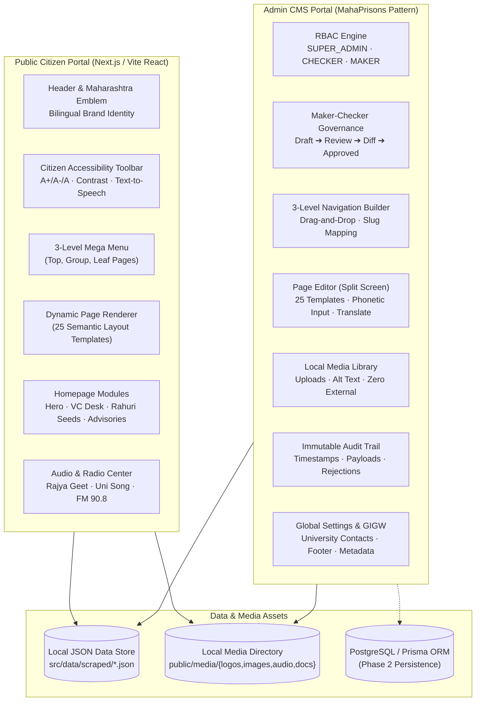

# Product Requirements Document (PRD): MPKV Rahuri Portal & Admin CMS

**Project Title:** MPKV Rahuri — Central University Portal & Modern Admin CMS  
**Document Version:** 1.0.0  
**Status:** Approved for Implementation  
**Architectural Baseline:** MahaPrisons Portal Architecture, User & Testing Guide Workflow (`SUPER_ADMIN`, `MAKER`, `CHECKER`, Maker-Checker review queue, Audit Logs, Media Library, Global Settings, 3-level Navigation Builder, Page Editor with 25 layout templates + Devanagari phonetic input / bidirectional translation, and Citizen Accessibility Suite).  
**Document Path:** `MPKV_Portal_PRD.md`

---

## 1. Executive Summary & Strict Core Constraints

### 1.1 Institutional Scope: Strictly Rahuri Campus & Headquarters Only
The portal is exclusively dedicated to **Mahatma Phule Krishi Vidyapeeth (MPKV), Rahuri** central headquarters and its Rahuri-based institutions:
1. **Central University Headquarters** at Rahuri (Vice-Chancellor Desk, Registrar, Comptroller, Director of Research, Director of Extension Education, Dean & Director of Instruction, Executive Council, Academic Council).
2. **Post Graduate Institute (PGI), Rahuri** (Post-graduate and Doctoral degrees, departments, faculty, hostels).
3. **Dr. Annasaheb Shinde College of Agricultural Engineering and Technology (Dr. A.S. CAET), Rahuri** (B.Tech, M.Tech, Ph.D. in Agricultural Engineering, laboratories, faculty).
4. **Rahuri Central Facilities & Infrastructure:**
   - Central University Library (Vasantrao Naik Memorial Library, Rahuri)
   - Agricultural Knowledge Management Unit (AKMU, Rahuri)
   - Agricultural Technology Information Centre (ATIC, Rahuri)
   - Communication Centre & Phule Krishi Vahini (90.8 FM Community Radio, Rahuri)
   - University Central Seed Processing Plant & Central Nursery, Rahuri
   - Horticulture Nursery & Farm, Rahuri
   - Biotechnology Research Centre & Radioisotope Lab, Rahuri
   - Hostels (Boys, Girls, International Students Hostel, Rahuri)
   - Dr. M.S. (Nanasaheb) Pawar Auditorium & Guest Houses, Rahuri
5. **Strict Exclusion of Outstations:** Outstation constituent colleges (Pune, Dhule, Kolhapur, Karad, Nandurbar, Muktainagar, Halgaon, Kashti) and outstation research/nursery tables are excluded from standalone pages and outstation stock tables.

### 1.2 Bilingual Fidelity (Marathi & English)
- Identical bilingual coverage across all menus, page titles, section blocks, announcements, seed/nursery tables, farm machinery catalogs, and administrative profiles.
- Switching between `मराठी` and `English` dynamically updates every UI element and page content node with 100% parity.

### 1.3 Verbatim Preservation of Official Scraped Data
- 100% character-for-character fidelity to official data scraped from `https://mpkv.ac.in/Home/IndexNew` and its Rahuri-related routes.
- Zero summarization, truncation, or paraphrasing of official names, Marathi descriptions, seed varieties, rates, telephone numbers, and designations.

### 1.4 Zero External Runtime Dependencies & Media Policy
- No live network requests to external servers for images, logos, audio files, or PDF documents during runtime.
- All scraped assets downloaded locally into `/public/media/{logos|images|audio|docs}/` with mapped relative paths and an auditable manifest.

### 1.5 Architecture Sequence: Frontend First, Then DB Persistence
- Phase 1–3: Complete public frontend and admin CMS UI functioning seamlessly on local typed JSON datasets and state.
- Subsequent Phase: Integration with PostgreSQL / Prisma persistence for production data storage.

---

## 2. System Architecture & Component Model

---

## 3. The 25 Semantic Layout Templates

Following the MahaPrisons architectural standard, all inner pages are rendered via 25 fixed semantic templates to ensure GIGW 3.0 accessibility, strict responsive grid layouts, and zero CSS breakage by editors:

| # | Template Key | Purpose in MPKV Rahuri Portal |
|---|---|---|
| 1 | `BasicFeatureGrid` | Rahuri overview, key university highlights, statistics counter, and contact card. |
| 2 | `CardsAndVerticalTimeline` | Historical milestones of MPKV Rahuri (1968 establishment to present). |
| 3 | `ContactInfoGrid` | Central administrative officer directory (Registrar, Comptroller, Deans) with phone/email. |
| 4 | `ContactUsLayout` | Rahuri campus central contact directory, grievance desk, and inquiry forms. |
| 5 | `ContentWithAccordion` | Academic regulations, RTI proactive disclosures, student FAQs, and hostel rules. |
| 6 | `ContentWithRightSidebar` | Vice-Chancellor's address flanked by quick links, profile card, and notification feeds. |
| 7 | `ContentWithTabs` | Post Graduate Institute (PGI) departments, faculties, and curricula. |
| 8 | `GalleryLayout` | Campus photo albums (auditorium, central library, farm, Convocation, research fields). |
| 9 | `HeroBannerWithArticles` | Agricultural advisories, university news bulletin, and research breakthroughs. |
| 10 | `HeroBannerWithBadges` | ICAR Sardar Patel Outstanding Institute awards, Best AICRP Centre awards, NIRF badges. |
| 11 | `HeroBannerWithMedia` | Multimedia showcase with Phule Krishi Vahini 90.8 FM player and documentary reels. |
| 12 | `HeroFeatureList` | Seed certification standards, nursery purchase procedures, and testing protocols. |
| 13 | `HeroFeaturesTimelineLayout` | Comprehensive College of Agricultural Engineering overview and modernization timeline. |
| 14 | `HeroSplitTimeline` | Central library collections balancing digital library initiatives against historical archives. |
| 15 | `HeroStatsGrid` | Research metrics: 270 crop varieties, 1577 recommendations, 39 farm implements, 13 patents. |
| 16 | `HeroThreeColGrid` | University mandates: High-quality Education, Pioneer Research, and Lab-to-Land Extension. |
| 17 | `HeroWithMenuGrid` | Farmer utility portal: ATIC services, Soil testing lab, Bio-fertilizers, and Seed counters. |
| 18 | `HeroWithPricingList` | Central Nursery rate card: grafting rates, seedling prices, and certified seed tariffs. |
| 19 | `HeroWithProcessGrid` | Step-by-step student admission process (Doctoral, Master's, B.Tech) and hostel allotment. |
| 20 | `IconsListWithTimeline` | Agricultural Knowledge Management Unit (AKMU) services and IT infrastructure rollout. |
| 21 | `MinimalIconGrid` | Citizen shortcuts: Seed stock, Nursery plants, Weather updates, and Advisories. |
| 22 | `ProductsLayout` | Rahuri Certified Seeds & Nursery Stock catalog with filterable crop categories and pricing. |
| 23 | `SideBySideListCards` | Comparative academic departments (Agronomy, Genetics, Soil Science, Horticulture). |
| 24 | `ThreeColServiceCards` | University testing services (Farm Machinery Testing Centre, Soil & Water Analysis, PDM). |
| 25 | `TwoColEventCards` | Scheduled events: Convocation, Joint AGRESCO, Krishi Mahotsav, and Farmers' Fair. |

---

## 4. Admin CMS Workflow & Governance

### 4.1 Scoped Roles & Responsibilities
- `SUPER_ADMIN`: Complete system authority, user management, global settings override, publish permissions, audit trail review.
- `CHECKER`: Approver role. Reviews submitted drafts from Makers in the Review Dashboard, inspects side-by-side visual diffs, approves (auto-publishing to live) or rejects with mandatory feedback notes.
- `MAKER`: Content creator. Drafts and edits pages, seed stock tables, advisories, announcements, and navigation menus. Cannot directly publish to live; must submit changes to the Checker queue with a change summary.

### 4.2 Split-Screen Page Editor & Bilingual Input Engine
- **Left Panel:** Real-time preview iframe showing the rendered public layout.
- **Right Panel:** Typed structured form fields with sticky section tabs.
- **Devanagari Phonetic Transliteration (`PhoneticInput`):** Real-time typing support (e.g., `rahuri` ➔ `राहुरी`, `biyane` ➔ `बियाणे`).
- **Bidirectional Marathi <-> English Translation:** One-click translation sync between paired bilingual fields.

---

## 5. Design Tokens & UI Aesthetics

- **Primary Colors:**
  - `Emerald University Green`: `#006837` (Primary brand color, representing agricultural heritage)
  - `Dark Emerald Forest`: `#084d28` (Topbar, mega-menu headers, dark accents)
  - `Harvest Gold`: `#f5a623` / `#d97706` (Accents, badges, active indicators, buttons)
  - `Warm Earth Cream`: `#fbfaf6` (Page background for high readability)
- **Typography:**
  - Latin: Inter, system sans-serif
  - Devanagari: Noto Sans Devanagari, Mukta
- **Citizen Accessibility (WCAG 2.1 AA & GIGW 3.0):**
  - Font Sizer: Three settings (`A-` 90%, `A` 100%, `A+` 115%)
  - High Contrast Mode (pure black background `#000000` with high-visibility amber text `#ffb700`)
  - Dark Theme Mode
  - Web Speech API integration (`Listen to Content / मजकूर ऐका`) for reading page text aloud.
